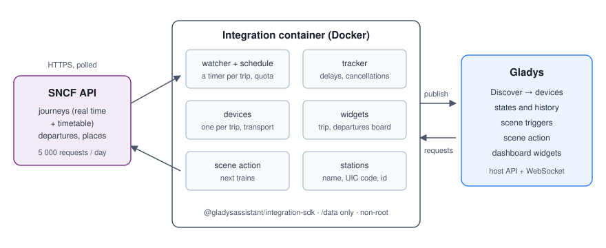
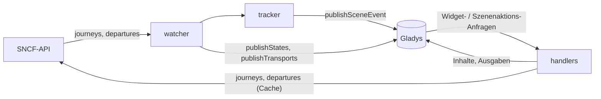
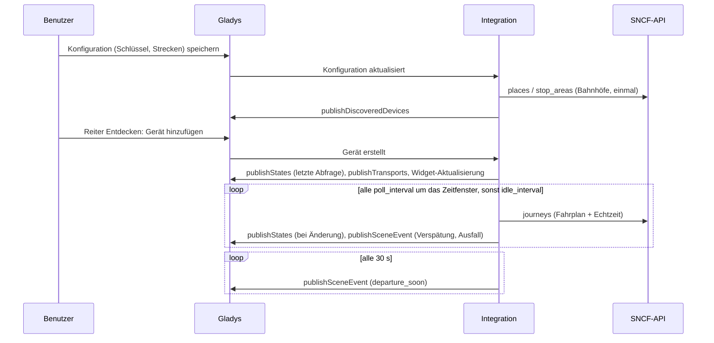
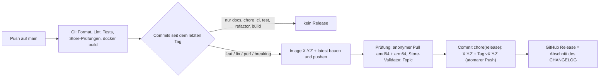

# Gladys SNCF

[English](README.md) · [Français](README.fr.md) · **Deutsch** · [Español](README.es.md)

[](LICENSE)
[](https://github.com/William-De71/gladys-sncf/releases)
[](https://github.com/William-De71/gladys-sncf/actions/workflows/release.yml)
[](https://gladysassistant.com)

Externe [Gladys Assistant](https://gladysassistant.com)-Integration für **SNCF-Züge**: die nächsten Züge deiner
Strecken in Echtzeit — Verspätungen, Ausfälle, Gründe — als Geräte, **Szenen-Auslöser**, eine **Szenenaktion**
und **Dashboard-Widgets**, gebaut auf `@gladysassistant/integration-sdk` 0.15.

Daten: die offizielle [SNCF-API](https://numerique.sncf.com/startup/api/) (eine Navitia-Instanz, kostenloser
Schlüssel, 5 000 Anfragen pro Tag). Echtzeit für TGV INOUI, OUIGO, Intercités, TER, Lyria und Eurostar; Transilien
nur als Fahrplan.

Benutzerdokumentation: [English](docs/en.md) · [Français](docs/fr.md) · [Deutsch](docs/de.md) ·
[Español](docs/es.md).

> Community-Integration, nicht mit der SNCF verbunden und nicht von ihr unterstützt.

## Inhalt

- [Funktionen](#funktionen)
- [Architektur](#architektur)
- [Installation](#installation)
- [Konfiguration](#konfiguration)
- [Funktionsweise](#funktionsweise)
- [Entwicklung](#entwicklung)
- [Release und Commit-Konvention](#release-und-commit-konvention)
- [Fehlerbehebung](#fehlerbehebung)
- [Mitwirken](#mitwirken)
- [Lizenz](#lizenz)

## Funktionen

### Geräte

Ein Gerät pro konfigurierter Strecke (bis zu 3), angeboten im Reiter Entdecken, alle Funktionen schreibgeschützt:

| Funktion                      | Kategorie / Typ              | Hinweise                                                            |
| ----------------------------- | ---------------------------- | ------------------------------------------------------------------- |
| Nächster Zug                  | `text` / `text`              | „07:42 · TER 858311 · +5 min“, „… · ausgefallen“                    |
| Verspätung des nächsten Zuges | `duration` / `integer` (min) | der nächste Zug, der fährt; unverändert, wenn kein Zug da ist       |
| Gestörte Züge                 | `counter-sensor` / `integer` | verfolgte Züge, die verspätet (ab der Schwelle) sind oder ausfallen |

Externe Kennungen: `ext:<selector>:trip:<UIC Abfahrt>-<UIC Ankunft>[:<Funktion>]` — einen Bahnhof anders
einzugeben behält das Gerät.

Jedes Gerät trägt ein Transport-Abzeichen (`transports: ["cloud"]`): `cloud`, solange die letzte Abfrage der
Strecke gelungen ist, `unreachable`, wenn sie fehlgeschlagen ist, `cloud` als **eingeschränkt** markiert (mit dem
Grund), solange die Abfragen wegen des Kontingents pausieren.

### Szenen-Auslöser

| Auslöser          | Löst aus, wenn…                                                                            | Filter                                              |
| ----------------- | ------------------------------------------------------------------------------------------ | --------------------------------------------------- |
| `train_delayed`   | ein verfolgter Zug verspätet wird (Schwelle), dann erneut bei 15 und 30 min                | Strecke (`source: "devices"`), Stufe (Mehrfachwahl) |
| `train_cancelled` | ein verfolgter Zug ausfällt oder nicht mehr an einem Bahnhof der Strecke hält              | Strecke                                             |
| `departure_soon`  | ein verfolgter Zug in 5/10/15/20/30/45/60 min abfährt, nach seiner Abfahrt **in Echtzeit** | Strecke, Minuten                                    |

Jedes Ereignis enthält die Strecke, den Zug (Nummer, Art, Richtung), die planmäßigen und voraussichtlichen
Zeiten, die Verspätung, den Grund und einen fertigen Satz `summary`. Jedes Ereignis wird einmal pro Zug
ausgelöst: Was ausgelöst wurde, bleibt einen Tag in `/data`, ein Neustart wiederholt also nie eine Szene.
Erinnerungen werden alle 30 s geprüft und innerhalb von 3 Minuten nach der Marke ausgelöst (nur die nächste: ein
Zug, der 8 Minuten vor der Abfahrt zum ersten Mal gesehen wird, löst „10“ aus, nie „10, 15, 20…“).

Beispiel: **SNCF: Zug fährt bald ab** (Strecke „Rennes → Nantes“, 15 min) → `{{triggerEvent.data.summary}}` über
den Lautsprecher ansagen („Rennes → Nantes: Der TER 858311 fährt in 15 min ab, um 07:47 (5 min Verspätung).“).

### Szenenaktion

`get_next_trains` (Strecke, leer = die erste): Nummer, Art, planmäßige und voraussichtliche Abfahrt,
voraussichtliche Ankunft, Verspätung, Status (`on_time` / `delayed` / `cancelled`), Minuten bis zur Abfahrt, Zahl
der gestörten Züge, Grund und ein Satz `summary` („Rennes → Nantes: Der TER 858311 um 07:42 hat 5 min
Verspätung, Abfahrt um 07:47. Danach: 08:12 pünktlich.“).

Beispiel: an jedem Werktag um 07:00 → **SNCF: nächste Züge** → die Ausgabe `summary` per Telegram senden.

### Dashboard-Widgets

| Widget  | Inhalt                                                                                                                                                        |
| ------- | ------------------------------------------------------------------------------------------------------------------------------------------------------------- |
| `trip`  | Kacheln „nächste Abfahrt“ und „Abfahrt in“, dann die verfolgten Züge mit einem Abzeichen pünktlich / +N min / fällt aus; ein gestörter Zug zeigt seinen Grund |
| `board` | Abfahrtstafel eines Bahnhofs (in den Einstellungen eingegeben oder der Abfahrtsbahnhof einer Strecke), alle Richtungen                                        |

`trip` wird bei jeder Änderung angestoßen (`requestWidgetRefresh`), beide Widgets, wenn ein Gerät hinzugefügt
wird. Außerhalb des Zeitfensters zeigt `trip` die Züge des nächsten Zeitfensters („Züge am Dienstag, 13.
Oktober“).

### Sprachen

Englisch, Französisch, Deutsch und Spanisch: Manifest, Laufzeitmeldungen, Widgets, Szenenzusammenfassungen und
Benutzerdokumentation. Gladys gibt die Sprache nur an die Widgets weiter; Gerätenamen und Szenentexte folgen der
Einstellung **Sprache der Texte** (`auto` = die Sprache der letzten Widget-Anfrage). Die Gründe der Verspätungen
kommen von der SNCF, auf Französisch.

## Architektur





Vom Reiter Entdecken zu einem Zustand und einer Szene:



Die Integration arbeitet nur über die Cloud (`transports: ["cloud"]`): Sie spricht mit der Web-API der SNCF und
mit nichts im lokalen Netzwerk.

## Installation

In Gladys: **Integrationen → Store → SNCF → Installieren**. Folge dann der
[Benutzerdokumentation](docs/de.md): API-Schlüssel, Strecken, **Verbindung testen**, Reiter Entdecken.

Docker-Image: `ghcr.io/william-de71/gladys-sncf`, Multi-Arch (amd64/arm64), ohne Root, schreibgeschütztes
Dateisystem, schreibt nur in `/data`, OCI-Labels und das Manifest im Label `io.gladysassistant.manifest`.

## Konfiguration

| Schlüssel                         | Typ            | Hinweise                                                                       |
| --------------------------------- | -------------- | ------------------------------------------------------------------------------ |
| `api_key`                         | `secret`       | Pflichtfeld (der SNCF-Schlüssel, eine UUID)                                    |
| `trip_<n>_from` / `trip_<n>_to`   | `string`       | n = 1–3: ein Bahnhofsname, ein UIC-Code (`87471003`) oder eine Navitia-Kennung |
| `trip_<n>_hours`                  | `string`       | optionales Zeitfenster, `07:00-09:30`, `7h-9h30`, `06:45 à 08:00`              |
| `trip_<n>_days`                   | `multi_select` | optionale Reisetage (leer = jeden Tag)                                         |
| `train_count`                     | `number`       | verfolgte Züge pro Strecke, 1–8, Standard 4                                    |
| `delay_threshold`                 | `number`       | Minuten, ab denen ein Zug verspätet ist, 1–30, Standard 5                      |
| `poll_interval` / `idle_interval` | `number`       | Minuten zwischen Abfragen um das Zeitfenster (2–30, 3) / sonst (10–180, 30)    |
| `language`                        | `select`       | `auto` (Standard), `en`, `fr`, `de`, `es`                                      |

Interner Schlüssel (außerhalb des Schemas): `last_language`. Aktionen des Manifests: `test_connection`,
`search_station` (liefert die passenden Bahnhöfe mit ihrer Kennung, zum Einfügen in ein Streckenfeld).

## Funktionsweise

**Bahnhöfe.** Ein Name wird einmal gesucht (`places?type[]=stop_area`, erstes Ergebnis) und in
`/data/stations.json` gespeichert; ein UIC-Code oder eine Kennung wird mit `stop_areas/<id>` geprüft.
Haltestellenbereiche, nie Haltepunkte: Ein Haltepunkt ist ein Bahnsteig für eine Zugart und verpasst die anderen.

**Züge.** `journeys` zwischen den beiden Haltestellenbereichen mit `max_nb_transfers=0` und `direct_path=none`;
der Zug ist der einzige Abschnitt `public_transport` (die Antwort umrahmt ihn mit `crow_fly`-Abschnitten der Länge
null). Die Verspätung ergibt sich aus `departure_date_time − base_departure_date_time` des Abschnitts. Die Zeiten
sind Pariser Ortszeit ohne Versatz, umgerechnet über `Intl` (Sommerzeit inbegriffen), nie über die Zeitzone des
Containers.

**Ausfälle.** Ein ausgefallener Zug (`NO_SERVICE`) verschwindet aus den Echtzeitantworten. Jede Abfrage holt den
Fahrplan (`base_schedule`) **und** die Echtzeit, zusammengeführt über Zugnummer + planmäßige Abfahrt: Ein
Fahrplanzug, der mit einer Störung `NO_SERVICE` verknüpft ist (per Link oder über Nummer und Verkehrstag in der
betroffenen Fahrt), fällt aus; einer, der fehlt, während ein späterer Zug da ist, ist _verdächtig_ und wird auf der
Abfahrtstafel des Bahnhofs geklärt (ausgefallen nur, wenn die Tafel sein Fehlen beweist — nie auf Verdacht). Ein
Zug, dessen Halt an einem Bahnhof der Strecke `deleted` ist (`REDUCED_SERVICE`), fällt für diese Strecke aus. Der
Ansatz stammt von der Home-Assistant-Integration
[glorp-fr/glorp_sncf_trajets](https://github.com/glorp-fr/glorp_sncf_trajets).

**Planung und Kontingent.** Mit Zeitfenster werden die Züge des nächsten Zeitfensters verfolgt (die des Tages,
solange es nicht vorbei ist, dann die des nächsten Reisetags), und die Strecke wird von einer Stunde vor dem
Zeitfenster bis zu seinem Ende alle `poll_interval` Minuten abgefragt, sonst alle `idle_interval` Minuten; ohne
Zeitfenster alle `poll_interval` Minuten, außer nachts (00:30–04:30). Eine Abfrage kostet 2 Anfragen (3, wenn ein
Ausfall bestätigt werden muss): etwa 250 Anfragen pro Tag und Strecke mit einem Zeitfenster von 2,5 Stunden, 800
ohne. Die Anfragen werden über gleitende 24 Stunden in `/data/quota.json` gezählt; die Abfragen pausieren bei
4 500 und lassen den Rest den Widgets, der Szenenaktion und dem Konfigurationsbildschirm. Ein `429` sperrt jede
Anfrage bis zu seinem `Retry-After` (standardmäßig eine Stunde). Widgets und Szenenaktion verwenden die letzte
Abfrage, solange sie jünger als 2 Minuten ist; die Abfahrtstafel wird 90 s zwischengespeichert. Die Geräte werden
mit `should_poll: false` veröffentlicht: Der Watcher ist der einzige Timer, und Zustände werden nur bei Änderung
veröffentlicht.

**Fehler.** `401`/`403` → „Schlüssel abgelehnt“ im Verbindungsstatus; `404 no_solution` → kein Zug; 5xx- und
Netzwerkfehler werden einmal wiederholt, dann werden die Abfragen bis zum Intervall außerhalb des Zeitfensters
gestreckt.

## Entwicklung

```bash
npm install
npm run format:check
npm run lint
npm test
npx github:GladysAssistant/integration-store . --skip-image-check
docker build -t gladys-sncf .
```

Node 22 oder neuer. Die Tests (`node --test`) greifen nie aufs Netzwerk zu: Sie laufen auf echten API-Antworten in
[`test/fixtures`](test/fixtures/README.md) und prüfen jeden Widget-Inhalt mit `validateWidgetContent` des SDK.
Über die Unit-Tests hinaus:

- `test/structure.test.js` vergleicht die externen Kennungen der Geräte, die Felder der Funktionen, die der Reiter
  Entdecken vergleicht, und jeden Schlüssel des Manifests mit `test/fixtures/discovery.baseline.json` (Version
  1.0.0): Bestehende Benutzer müssen nie ein Gerät neu anlegen;
- `test/i18n.test.js` prüft die vier Sprachen (Manifest, Laufzeittexte, Dokumentation, READMEs) und validiert die
  Widget-Inhalte in jeder;
- `test/release.test.js` deckt das Release-Skript ab (Version, Changelog, Bump).

`gladys_version` ist `>=5.1.1` (Widgets, Szenen-Auslöser und -Aktionen, `source: "devices"`).

Nur für die Entwicklung: `SNCF_API_URL` richtet den Client auf eine andere API, `SNCF_DATA_DIR` verschiebt die
Dateien von `/data`.

## Release und Commit-Konvention

Releases laufen automatisch. Jeder Push auf `main` startet den Release-Workflow:



- Commits und PR-Titel folgen [Conventional Commits](https://www.conventionalcommits.org/), auf Englisch, für den
  Benutzer geschrieben: Sie werden zu den Zeilen des Changelogs. `feat` → Minor, `fix` / `perf` → Patch, `!` oder
  `BREAKING CHANGE:` → Major.
- `CHANGELOG.md` wird beim Release erzeugt: nie von Hand bearbeiten.
- Das Image wird veröffentlicht und geprüft, **bevor** das Manifest auf `main` die neue Version ankündigt.
- Manueller Start (Actions → Release → Run workflow): `release-as` erzwingt eine Version, `dry-run` zeigt nur die
  Version und die Notizen.
- Ein geschützter `main`-Branch würde den Release-Commit ablehnen: Erlaube GitHub Actions, die Regel zu umgehen,
  oder nutze das Token einer GitHub App.

## Fehlerbehebung

| Symptom                                         | Wahrscheinliche Ursache                                                                                                |
| ----------------------------------------------- | ---------------------------------------------------------------------------------------------------------------------- |
| „Der SNCF-API-Schlüssel wird abgelehnt“         | Schlüssel falsch aus der E-Mail kopiert (ein Leerzeichen, ein fehlendes Zeichen)                                       |
| „Bahnhof nicht gefunden: …“                     | der Name passt zu keinem Bahnhof: **Bahnhof suchen** nutzen und die Kennung einfügen                                   |
| „Tageskontingent der SNCF-API erreicht“         | die SNCF hat den Schlüssel bis zur angezeigten Uhrzeit gesperrt: weniger Strecken ohne Zeitfenster, längere Intervalle |
| „Kein Zug im verfolgten Zeitraum gefunden“      | kein Direktzug zwischen den Bahnhöfen im Zeitfenster (ein Umstieg wird nie verfolgt)                                   |
| Gerätenamen oder Zusammenfassungen auf Englisch | **Sprache der Texte** einstellen oder einmal ein SNCF-Widget öffnen                                                    |

Ausführliche Logs: Setze die Umgebungsvariable `DEBUG=gladys-integration-sdk` am Container.

## Mitwirken

Issues und Pull Requests sind willkommen: Fehlerberichte mit der Gladys-Version, der Version der Integration und
den Logs ([Issue-Vorlagen](.github/ISSUE_TEMPLATE)). Rückmeldungen auch im
[Thread des Gladys-Forums](https://community.gladysassistant.com/t/integration-externe-sncf-vos-trains-en-temps-reel-dans-gladys/11037).
Sicherheitsprobleme: siehe [SECURITY.md](SECURITY.md).

## Lizenz

[Apache-2.0](LICENSE) — siehe [NOTICE](NOTICE).
