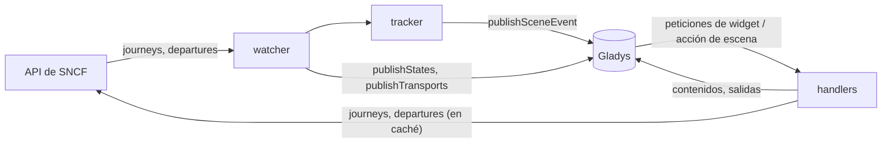
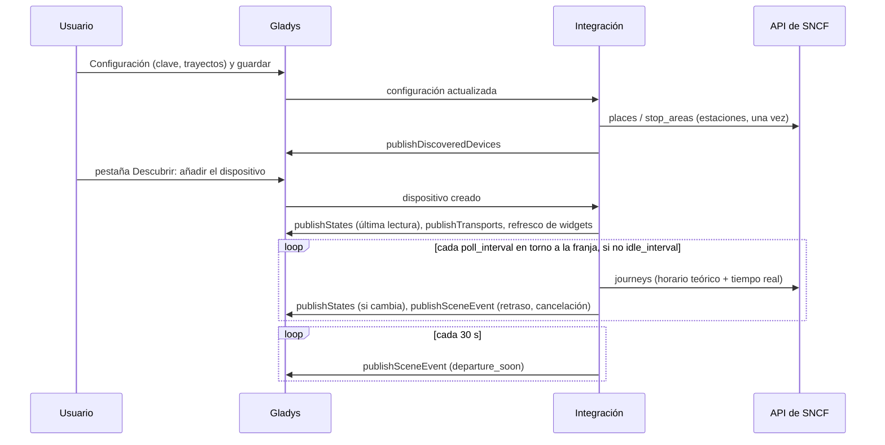
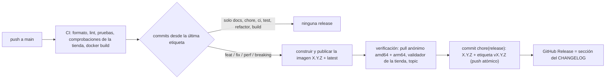

# Gladys SNCF

[English](README.md) · [Français](README.fr.md) · [Deutsch](README.de.md) · **Español**

[](LICENSE)
[](https://github.com/William-De71/gladys-sncf/releases)
[](https://github.com/William-De71/gladys-sncf/actions/workflows/release.yml)
[](https://gladysassistant.com)

Integración externa de [Gladys Assistant](https://gladysassistant.com) para los **trenes SNCF**: los próximos
trenes de tus trayectos en tiempo real — retrasos, cancelaciones, motivos — como dispositivos, **disparadores de
escena**, una **acción de escena** y **widgets del panel**, construida sobre `@gladysassistant/integration-sdk`
0.15.

Datos: la [API de SNCF](https://numerique.sncf.com/startup/api/) oficial (una instancia de Navitia, clave
gratuita, 5 000 peticiones al día). Tiempo real para TGV INOUI, OUIGO, Intercités, TER, Lyria y Eurostar;
Transilien solo con horario teórico.

Documentación de usuario: [English](docs/en.md) · [Français](docs/fr.md) · [Deutsch](docs/de.md) ·
[Español](docs/es.md).

> Integración comunitaria, sin relación con SNCF ni respaldada por ella.

## Índice

- [Funcionalidades](#funcionalidades)
- [Arquitectura](#arquitectura)
- [Instalación](#instalación)
- [Configuración](#configuración)
- [Funcionamiento](#funcionamiento)
- [Desarrollo](#desarrollo)
- [Release y convención de commits](#release-y-convención-de-commits)
- [Solución de problemas](#solución-de-problemas)
- [Contribuir](#contribuir)
- [Licencia](#licencia)

## Funcionalidades

### Dispositivos

Un dispositivo por trayecto configurado (hasta 3), propuesto en la pestaña Descubrir, todas las funcionalidades
de solo lectura:

| Funcionalidad            | Categoría / tipo             | Notas                                                              |
| ------------------------ | ---------------------------- | ------------------------------------------------------------------ |
| Próximo tren             | `text` / `text`              | «07:42 · TER 858311 · +5 min», «… · cancelado»                     |
| Retraso del próximo tren | `duration` / `integer` (min) | el próximo tren que circula; sin cambios cuando no hay ningún tren |
| Trenes con incidencias   | `counter-sensor` / `integer` | trenes seguidos con retraso (desde el umbral) o cancelados         |

Identificadores externos: `ext:<selector>:trip:<UIC salida>-<UIC llegada>[:<funcionalidad>]` — escribir una
estación de otra forma conserva el dispositivo.

Cada dispositivo lleva una insignia de transporte (`transports: ["cloud"]`): `cloud` mientras la última lectura
del trayecto ha funcionado, `unreachable` cuando ha fallado, `cloud` marcado como **degradado** (con el motivo)
mientras las lecturas están en pausa por la cuota.

### Disparadores de escena

| Disparador        | Se dispara cuando…                                                                         | Filtros                                                    |
| ----------------- | ------------------------------------------------------------------------------------------ | ---------------------------------------------------------- |
| `train_delayed`   | un tren seguido se retrasa (umbral), y de nuevo a los 15 y 30 min                          | trayecto (`source: "devices"`), nivel (selección múltiple) |
| `train_cancelled` | un tren seguido se cancela, o ya no para en una estación del trayecto                      | trayecto                                                   |
| `departure_soon`  | un tren seguido sale dentro de 5/10/15/20/30/45/60 min, según su salida **en tiempo real** | trayecto, minutos                                          |

Cada evento lleva el trayecto, el tren (número, tipo, dirección), las horas previstas y estimadas, el retraso, el
motivo y una frase `summary` lista. Cada evento se dispara una sola vez por tren: lo disparado se guarda un día en
`/data`, así que un reinicio nunca repite una escena. Los avisos se comprueban cada 30 s y se disparan en los 3
minutos siguientes a la marca (solo la más cercana: un tren visto por primera vez 8 minutos antes de salir dispara
«10», nunca «10, 15, 20…»).

Ejemplo: **SNCF: salida inminente** (trayecto «Rennes → Nantes», 15 min) → anunciar
`{{triggerEvent.data.summary}}` por el altavoz («Rennes → Nantes: el TER 858311 sale dentro de 15 min, a las 07:47
(5 min de retraso).»).

### Acción de escena

`get_next_trains` (trayecto, vacío = el primero): número, tipo, salida prevista y estimada, llegada estimada,
retraso, estado (`on_time` / `delayed` / `cancelled`), minutos hasta la salida, número de trenes con incidencias,
motivo y una frase `summary` («Rennes → Nantes: el TER 858311 de las 07:42 lleva 5 min de retraso, sale a las
07:47. Después: 08:12 en hora.»).

Ejemplo: cada día laborable a las 07:00 → **SNCF: próximos trenes** → enviar su salida `summary` por Telegram.

### Widgets del panel

| Widget  | Contenido                                                                                                                                                         |
| ------- | ----------------------------------------------------------------------------------------------------------------------------------------------------------------- |
| `trip`  | casillas de la próxima salida y «sale en», y después los trenes seguidos con una insignia puntual / +N min / cancelado; un tren con incidencias muestra su motivo |
| `board` | panel de salidas de una estación (escrita en los ajustes, o la estación de salida de un trayecto), todas las direcciones                                          |

`trip` se refresca (`requestWidgetRefresh`) en cada cambio, y los dos widgets cuando se añade un dispositivo. Fuera
de la franja horaria, `trip` muestra los trenes de la próxima franja («Trenes del martes, 13 de octubre»).

### Idiomas

Inglés, francés, alemán y español: manifiesto, mensajes en ejecución, widgets, resúmenes de escena y documentación
de usuario. Gladys solo da el idioma a los widgets; los nombres de dispositivos y los textos de escena siguen el
ajuste **Idioma de los textos** (`auto` = el idioma de la última petición de widget). Los motivos de los retrasos
los da SNCF, en francés.

## Arquitectura




De la pestaña Descubrir a un estado y una escena:



La integración funciona solo en la nube (`transports: ["cloud"]`): habla con la API web de SNCF y con nada de la
red local.

## Instalación

Desde Gladys: **Integraciones → tienda → SNCF → Instalar**. Después sigue la
[documentación de usuario](docs/es.md): clave de API, trayectos, **Probar la conexión**, pestaña Descubrir.

Imagen Docker: `ghcr.io/william-de71/gladys-sncf`, multiarquitectura (amd64/arm64), sin root, sistema de archivos
de solo lectura, escribe solo en `/data`, etiquetas OCI y el manifiesto en la etiqueta
`io.gladysassistant.manifest`.

## Configuración

| Clave                             | Tipo           | Notas                                                                                 |
| --------------------------------- | -------------- | ------------------------------------------------------------------------------------- |
| `api_key`                         | `secret`       | obligatoria (la clave de SNCF, un UUID)                                               |
| `trip_<n>_from` / `trip_<n>_to`   | `string`       | n = 1–3: un nombre de estación, un código UIC (`87471003`) o un identificador Navitia |
| `trip_<n>_hours`                  | `string`       | franja opcional, `07:00-09:30`, `7h-9h30`, `06:45 à 08:00`                            |
| `trip_<n>_days`                   | `multi_select` | días de viaje opcionales (vacío = todos los días)                                     |
| `train_count`                     | `number`       | trenes seguidos por trayecto, 1–8, 4 por defecto                                      |
| `delay_threshold`                 | `number`       | minutos a partir de los cuales un tren va retrasado, 1–30, 5 por defecto              |
| `poll_interval` / `idle_interval` | `number`       | minutos entre lecturas en torno a la franja (2–30, 3) / si no (10–180, 30)            |
| `language`                        | `select`       | `auto` (por defecto), `en`, `fr`, `de`, `es`                                          |

Clave interna (fuera del esquema): `last_language`. Acciones del manifiesto: `test_connection`, `search_station`
(devuelve las estaciones que coinciden con su identificador, para pegarlo en un campo de trayecto).

## Funcionamiento

**Estaciones.** Un nombre se busca una vez (`places?type[]=stop_area`, primer resultado) y se guarda en
`/data/stations.json`; un código UIC o un identificador se comprueba con `stop_areas/<id>`. Zonas de parada, nunca
puntos de parada: un punto de parada es un andén para un tipo de tren y no ve los demás.

**Trenes.** `journeys` entre las dos zonas de parada con `max_nb_transfers=0` y `direct_path=none`; el tren es la
única sección `public_transport` (la respuesta la enmarca con secciones `crow_fly` de longitud cero). El retraso
sale de `departure_date_time − base_departure_date_time` de la sección. Las fechas están en hora local de París sin
desfase, convertidas con `Intl` (horario de verano incluido), nunca con la zona horaria del contenedor.

**Cancelaciones.** Un tren cancelado (`NO_SERVICE`) desaparece de las respuestas en tiempo real. Cada lectura
obtiene el horario teórico (`base_schedule`) **y** el tiempo real, combinados por número de tren + salida prevista:
un tren teórico vinculado a una incidencia `NO_SERVICE` (por enlace, o por número y fecha de circulación en el viaje
afectado) está cancelado; uno que falta mientras un tren posterior sí está es _sospechoso_, y se decide en el panel
de salidas de la estación (cancelado solo si el panel prueba su ausencia — nunca por suposición). Un tren cuya
parada en una estación del trayecto está `deleted` (`REDUCED_SERVICE`) queda cancelado para ese trayecto. El
enfoque es el de la integración de Home Assistant
[glorp-fr/glorp_sncf_trajets](https://github.com/glorp-fr/glorp_sncf_trajets).

**Planificación y cuota.** Con franja, se siguen los trenes de la próxima franja (los del día mientras no haya
terminado, después los del siguiente día de viaje) y el trayecto se lee cada `poll_interval` minutos desde una
hora antes de la franja hasta su final, y cada `idle_interval` minutos el resto; sin franja, cada `poll_interval`
minutos salvo de noche (00:30–04:30). Una lectura cuesta 2 peticiones (3 cuando hay que confirmar una
cancelación): unas 250 peticiones al día por trayecto con una franja de 2 h 30, 800 sin ella. Las peticiones se
cuentan sobre 24 horas móviles en `/data/quota.json`; las lecturas se pausan a 4 500, dejando el resto a los
widgets, a la acción de escena y a la pantalla de configuración. Un `429` bloquea toda petición hasta su
`Retry-After` (una hora por defecto). Los widgets y la acción de escena reutilizan la última lectura mientras tenga
menos de 2 minutos; el panel de salidas se guarda 90 s. Los dispositivos se publican con `should_poll: false`: el
watcher es el único temporizador, y los estados solo se publican cuando cambian.

**Errores.** `401`/`403` → «clave rechazada» en el estado de conexión; `404 no_solution` → ningún tren; los 5xx y
los fallos de red se reintentan una vez, y después las lecturas se espacian hasta el intervalo fuera de la franja.

## Desarrollo

```bash
npm install
npm run format:check
npm run lint
npm test
npx github:GladysAssistant/integration-store . --skip-image-check
docker build -t gladys-sncf .
```

Node 22 o posterior. Las pruebas (`node --test`) nunca tocan la red: se ejecutan sobre respuestas reales de la API
guardadas en [`test/fixtures`](test/fixtures/README.md) y comprueban cada contenido de widget con
`validateWidgetContent` del SDK. Además de las pruebas unitarias:

- `test/structure.test.js` compara los identificadores externos de los dispositivos, los campos de las
  funcionalidades que compara la pestaña Descubrir y cada clave del manifiesto con
  `test/fixtures/discovery.baseline.json` (versión 1.0.0): los usuarios existentes nunca tienen que recrear un
  dispositivo;
- `test/i18n.test.js` comprueba los cuatro idiomas (manifiesto, textos en ejecución, documentación, README) y
  valida los contenidos de widget en cada uno;
- `test/release.test.js` cubre el script de release (versión, changelog, bump).

`gladys_version` es `>=5.1.1` (widgets, disparadores y acciones de escena, `source: "devices"`).

Solo para desarrollo, `SNCF_API_URL` apunta el cliente a otra API y `SNCF_DATA_DIR` mueve los archivos de `/data`.

## Release y convención de commits

Las releases son automáticas. Cada push a `main` lanza el workflow Release:



- Los commits y títulos de PR siguen [Conventional Commits](https://www.conventionalcommits.org/), en inglés,
  escritos para el usuario: se convierten en las líneas del changelog. `feat` → minor, `fix` / `perf` → patch, `!`
  o `BREAKING CHANGE:` → major.
- `CHANGELOG.md` se genera en la release: nunca lo edites a mano.
- La imagen se publica y se comprueba **antes** de que el manifiesto en `main` anuncie la nueva versión.
- Ejecución manual (Actions → Release → Run workflow): `release-as` fuerza una versión, `dry-run` solo muestra la
  versión y las notas.
- Una rama `main` protegida rechazaría el commit de release: permite que GitHub Actions omita la regla, o usa el
  token de una GitHub App.

## Solución de problemas

| Síntoma                                        | Causa probable                                                                                       |
| ---------------------------------------------- | ---------------------------------------------------------------------------------------------------- |
| «La clave de API de SNCF es rechazada»         | clave mal copiada del correo (un espacio, un carácter que falta)                                     |
| «Estación no encontrada: …»                    | el nombre no corresponde a ninguna estación: usa **Buscar una estación** y pega el identificador     |
| «Cuota diaria de la API de SNCF alcanzada»     | SNCF ha bloqueado la clave hasta la hora indicada: menos trayectos sin franja, intervalos más largos |
| «Ningún tren encontrado en el periodo seguido» | ningún tren directo entre las estaciones en la franja (nunca se sigue un transbordo)                 |
| Nombres de dispositivos o resúmenes en inglés  | ajusta **Idioma de los textos**, o abre una vez un widget de SNCF                                    |

Logs detallados: define la variable de entorno `DEBUG=gladys-integration-sdk` en el contenedor.

## Contribuir

Las issues y pull requests son bienvenidas: informes de error con la versión de Gladys, la de la integración y los
logs ([plantillas de issue](.github/ISSUE_TEMPLATE)). También los comentarios en el
[hilo del foro de Gladys](https://community.gladysassistant.com/t/integration-externe-sncf-vos-trains-en-temps-reel-dans-gladys/11037).
Problemas de seguridad: ver [SECURITY.md](SECURITY.md).

## Licencia

[Apache-2.0](LICENSE) — ver [NOTICE](NOTICE).
