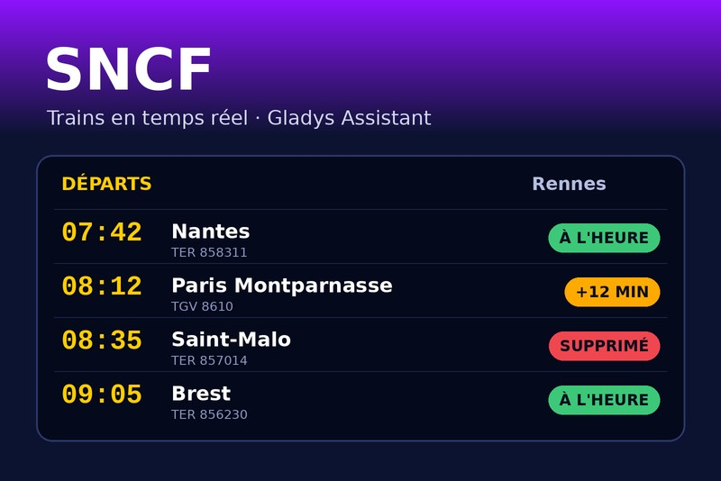
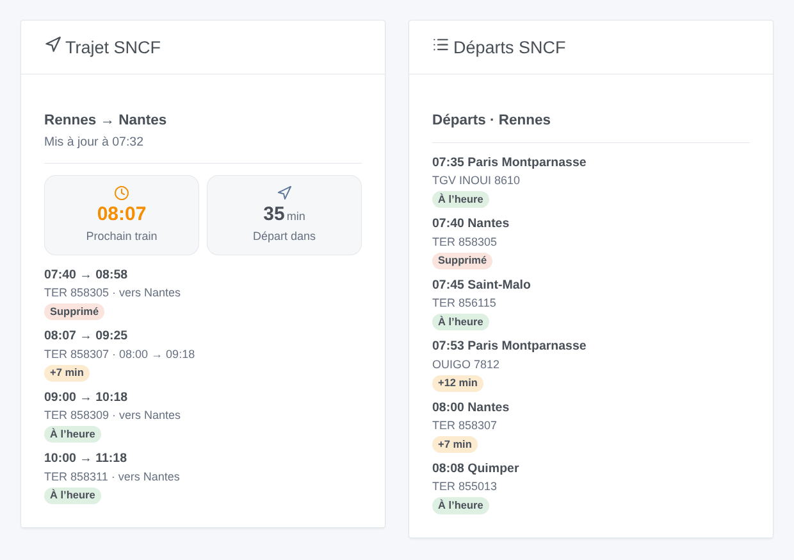
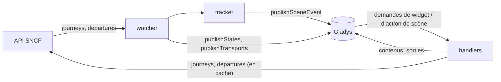
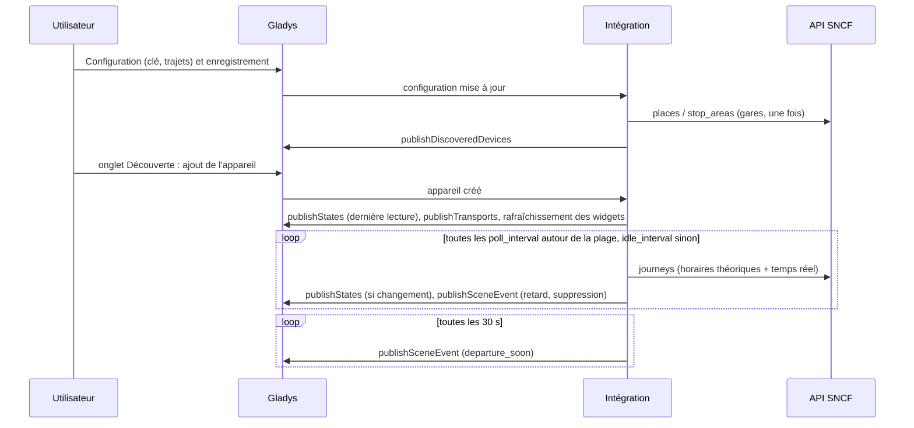
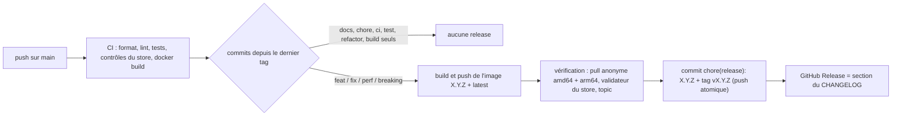

# Gladys SNCF

[English](README.md) · **Français** · [Deutsch](README.de.md) · [Español](README.es.md)

[](LICENSE)
[](https://github.com/William-De71/gladys-sncf/releases)
[](https://github.com/William-De71/gladys-sncf/actions/workflows/release.yml)
[](https://gladysassistant.com)



Intégration externe [Gladys Assistant](https://gladysassistant.com) pour les **trains SNCF** : les prochains trains
de vos trajets en temps réel — retards, suppressions, motifs — sous forme d'appareils, de **déclencheurs de
scène**, d'une **action de scène** et de **widgets de tableau de bord**, avec `@gladysassistant/integration-sdk`
0.15.

Données : l'[API SNCF](https://numerique.sncf.com/startup/api/) officielle (une instance Navitia, clé gratuite,
5 000 requêtes par jour). Temps réel pour les TGV INOUI, OUIGO, Intercités, TER, Lyria et Eurostar ; Transilien en
horaires théoriques seulement.

Documentation utilisateur : [English](docs/en.md) · [Français](docs/fr.md) · [Deutsch](docs/de.md) ·
[Español](docs/es.md).

> Intégration communautaire, sans lien avec la SNCF.

## Sommaire

- [Fonctionnalités](#fonctionnalités)
- [Architecture](#architecture)
- [Installation](#installation)
- [Configuration](#configuration)
- [Fonctionnement](#fonctionnement)
- [Développement](#développement)
- [Release et convention de commits](#release-et-convention-de-commits)
- [Dépannage](#dépannage)
- [Contribuer](#contribuer)
- [Licence](#licence)

## Fonctionnalités

### Appareils

Un appareil par trajet configuré (jusqu'à 3), proposé dans l'onglet Découverte, toutes fonctionnalités en
lecture seule :

| Fonctionnalité           | Catégorie / type             | Notes                                                               |
| ------------------------ | ---------------------------- | ------------------------------------------------------------------- |
| Prochain train           | `text` / `text`              | « 07:42 · TER 858311 · +5 min », « … · supprimé »                   |
| Retard du prochain train | `duration` / `integer` (min) | le prochain train qui circule ; inchangé quand il n'y a aucun train |
| Trains perturbés         | `counter-sensor` / `integer` | trains suivis en retard (à partir du seuil) ou supprimés            |

Identifiants externes : `ext:<selector>:trip:<UIC départ>-<UIC arrivée>[:<fonctionnalité>]` — saisir une gare
autrement conserve l'appareil.

Chaque appareil porte un badge de transport (`transports: ["cloud"]`) : `cloud` tant que la dernière lecture du
trajet a réussi, `unreachable` quand elle a échoué, `cloud` marqué **dégradé** (avec le motif) quand les lectures
sont en pause à cause du quota.

### Déclencheurs de scène

| Déclencheur       | Se déclenche quand…                                                                | Filtres                                            |
| ----------------- | ---------------------------------------------------------------------------------- | -------------------------------------------------- |
| `train_delayed`   | un train suivi prend du retard (seuil), puis à nouveau à 15 et 30 min              | trajet (`source: "devices"`), niveau (multi-choix) |
| `train_cancelled` | un train suivi est supprimé, ou ne dessert plus une gare du trajet                 | trajet                                             |
| `departure_soon`  | un train suivi part dans 5/10/15/20/30/45/60 min, sur son départ **en temps réel** | trajet, minutes                                    |

Chaque événement porte le trajet, le train (numéro, type, direction), les heures prévues et estimées, le retard,
le motif et une phrase `summary` toute prête. Chaque événement ne se déclenche qu'une fois par train : ce qui a été
déclenché est gardé un jour dans `/data`, un redémarrage ne rejoue donc jamais une scène. Les rappels sont vérifiés
toutes les 30 s et déclenchés dans les 3 minutes du palier (le plus proche seulement : un train vu pour la première
fois 8 minutes avant son départ déclenche « 10 », jamais « 10, 15, 20… »).

Exemple : **SNCF : départ imminent** (trajet « Rennes → Nantes », 15 min) → annoncer
`{{triggerEvent.data.summary}}` sur l'enceinte (« Rennes → Nantes : le TER 858311 part dans 15 min, à 07:47 (5
min de retard). »).

### Action de scène

`get_next_trains` (trajet, vide = le premier) : numéro, type, départ prévu et estimé, arrivée estimée, retard, état
(`on_time` / `delayed` / `cancelled`), minutes avant le départ, nombre de trains perturbés, motif et une phrase
`summary` (« Rennes → Nantes : le TER 858311 de 07:42 a 5 min de retard, départ à 07:47. Ensuite : 08:12 à
l'heure. »).

Exemple : chaque matin de semaine à 7 h → **SNCF : prochains trains** → envoyer sa sortie `summary` sur Telegram.

### Widgets de tableau de bord



| Widget  | Contenu                                                                                                                                              |
| ------- | ---------------------------------------------------------------------------------------------------------------------------------------------------- |
| `trip`  | tuiles du prochain départ et « départ dans », puis les trains suivis avec un badge à l'heure / +N min / supprimé ; un train perturbé ouvre son motif |
| `board` | tableau des départs d'une gare (saisie dans les réglages, ou la gare de départ d'un trajet), toutes directions                                       |

`trip` est relancé (`requestWidgetRefresh`) à chaque changement, et les deux widgets quand un appareil est ajouté.
En dehors de la plage horaire, `trip` montre les trains de la prochaine plage (« Trains du mardi 13 octobre »).

### Langues

Anglais, français, allemand et espagnol : manifeste, messages à l'exécution, widgets, résumés de scène et docs
utilisateur. Gladys ne donne la langue qu'aux widgets ; les noms d'appareils et les textes de scène suivent le
réglage **Langue des textes** (`auto` = la langue de la dernière demande de widget). Les motifs des retards viennent
de la SNCF, en français.

## Architecture




De l'onglet Découverte à un état et une scène :



L'intégration est uniquement cloud (`transports: ["cloud"]`) : elle parle à l'API web de la SNCF et à rien sur le
réseau local.

## Installation

Depuis Gladys : **Intégrations → store → SNCF → Installer**. Suivez ensuite la
[documentation utilisateur](docs/fr.md) : clé d'API, trajets, **Tester la connexion**, onglet Découverte.

Image Docker : `ghcr.io/william-de71/gladys-sncf`, multi-architecture (amd64/arm64), sans root, système de
fichiers en lecture seule, écrit uniquement dans `/data`, labels OCI et manifeste dans le label
`io.gladysassistant.manifest`.

## Configuration

| Clé                               | Type           | Notes                                                                         |
| --------------------------------- | -------------- | ----------------------------------------------------------------------------- |
| `api_key`                         | `secret`       | obligatoire (la clé SNCF, un UUID)                                            |
| `trip_<n>_from` / `trip_<n>_to`   | `string`       | n = 1–3 : un nom de gare, un code UIC (`87471003`) ou un identifiant Navitia  |
| `trip_<n>_hours`                  | `string`       | plage optionnelle, `07:00-09:30`, `7h-9h30`, `06:45 à 08:00`                  |
| `trip_<n>_days`                   | `multi_select` | jours de trajet optionnels (vide = tous les jours)                            |
| `train_count`                     | `number`       | trains suivis par trajet, 1–8, 4 par défaut                                   |
| `delay_threshold`                 | `number`       | minutes à partir desquelles un train est en retard, 1–30, 5 par défaut        |
| `poll_interval` / `idle_interval` | `number`       | minutes entre deux lectures autour de la plage (2–30, 3) / sinon (10–180, 30) |
| `language`                        | `select`       | `auto` (par défaut), `en`, `fr`, `de`, `es`                                   |

Clé interne (hors schéma) : `last_language`. Actions du manifeste : `test_connection`, `search_station` (renvoie
les gares correspondantes avec leur identifiant, à coller dans un champ de trajet).

## Fonctionnement

**Gares.** Un nom est cherché une fois (`places?type[]=stop_area`, premier résultat) et mémorisé dans
`/data/stations.json` ; un code UIC ou un identifiant est vérifié par `stop_areas/<id>`. Des zones d'arrêt, jamais
des points d'arrêt : un point d'arrêt est un quai pour un type de train et manque les autres.

**Trains.** `journeys` entre les deux zones d'arrêt avec `max_nb_transfers=0` et `direct_path=none` ; le train est
l'unique section `public_transport` (la réponse l'encadre de sections `crow_fly` de longueur nulle). Le retard vient
de `departure_date_time − base_departure_date_time` de la section. Les dates sont en heure locale de Paris sans
décalage, converties par `Intl` (heure d'été comprise), jamais par le fuseau du conteneur.

**Suppressions.** Un train supprimé (`NO_SERVICE`) disparaît des réponses temps réel. Chaque lecture récupère les
horaires théoriques (`base_schedule`) **et** le temps réel, fusionnés par numéro de train + départ prévu : un train
théorique lié à une perturbation `NO_SERVICE` (par lien, ou par numéro et date de circulation dans le trajet
impacté) est supprimé ; un train absent alors qu'un train plus tardif est là est _suspect_, tranché sur le tableau
des départs de la gare (supprimé seulement si le tableau prouve son absence — jamais sur une supposition). Un train
dont l'arrêt à une gare du trajet est `deleted` (`REDUCED_SERVICE`) est supprimé pour ce trajet. L'approche est
celle de l'intégration Home Assistant [glorp-fr/glorp_sncf_trajets](https://github.com/glorp-fr/glorp_sncf_trajets).

**Planification et quota.** Avec une plage, les trains de la prochaine plage sont suivis (ceux du jour tant qu'elle
n'est pas terminée, puis ceux du prochain jour de trajet) et le trajet est lu toutes les `poll_interval` minutes
d'une heure avant la plage jusqu'à sa fin, toutes les `idle_interval` minutes sinon ; sans plage, toutes les
`poll_interval` minutes sauf la nuit (00:30–04:30). Une lecture coûte 2 requêtes (3 quand une suppression doit être
confirmée) : environ 250 requêtes par jour par trajet avec une plage de 2 h 30, 800 sans. Les requêtes sont
comptées sur 24 heures glissantes dans `/data/quota.json` ; les lectures se mettent en pause à 4 500, laissant le
reste aux widgets, à l'action de scène et à l'écran de configuration. Un `429` bloque toute requête jusqu'à son
`Retry-After` (une heure par défaut). Les widgets et l'action de scène réutilisent la dernière lecture tant qu'elle
a moins de 2 minutes ; le tableau des départs est gardé 90 s. Les appareils sont publiés avec
`should_poll: false` : le watcher est le seul minuteur, et les états ne sont publiés que s'ils changent.

**Erreurs.** `401`/`403` → « clé refusée » dans l'état de connexion ; `404 no_solution` → aucun train ; les 5xx et
les erreurs réseau sont réessayés une fois, puis les lectures s'espacent jusqu'à l'intervalle hors plage.

## Développement

```bash
npm install
npm run format:check
npm run lint
npm test
npx github:GladysAssistant/integration-store . --skip-image-check
docker build -t gladys-sncf .
```

Node 22 ou plus. Les tests (`node --test`) ne touchent jamais le réseau : ils tournent sur de vraies réponses de
l'API gardées dans [`test/fixtures`](test/fixtures/README.md) et vérifient chaque contenu de widget avec
`validateWidgetContent` du SDK. Au-delà des tests unitaires :

- `test/structure.test.js` compare les identifiants externes des appareils, les champs des fonctionnalités que
  l'onglet Découverte compare et chaque clé du manifeste à `test/fixtures/discovery.baseline.json` (version
  1.0.0) : les utilisateurs existants n'ont jamais à recréer un appareil ;
- `test/i18n.test.js` vérifie les quatre langues (manifeste, textes à l'exécution, docs, README) et valide les
  contenus de widget dans chacune ;
- `test/release.test.js` couvre le script de release (version, changelog, bump).
- `docs/illustrations/render.sh` régénère les illustrations des widgets de `docs/assets` à partir du code des
  widgets (Chrome headless, styles du front Gladys) : relancez-le après tout changement d’un widget.

`gladys_version` vaut `>=5.1.1` (widgets, déclencheurs et actions de scène, `source: "devices"`).

En développement seulement, `SNCF_API_URL` pointe le client vers une autre API et `SNCF_DATA_DIR` déplace les
fichiers de `/data`.

## Release et convention de commits

Les releases sont automatiques. Chaque push sur `main` lance le workflow Release :



- Les commits et titres de PR suivent [Conventional Commits](https://www.conventionalcommits.org/), en anglais,
  rédigés pour l'utilisateur : ils deviennent les lignes du changelog. `feat` → minor, `fix` / `perf` → patch,
  `!` ou `BREAKING CHANGE:` → major.
- `CHANGELOG.md` est généré à la release : ne jamais l'éditer à la main.
- L'image est publiée et vérifiée **avant** que le manifeste sur `main` annonce la nouvelle version.
- Lancement manuel (Actions → Release → Run workflow) : `release-as` force une version, `dry-run` affiche seulement
  la version et les notes.
- Une branche `main` protégée refuserait le commit de release : autorisez GitHub Actions à contourner la règle, ou
  utilisez le jeton d'une GitHub App.

## Dépannage

| Symptôme                                     | Cause probable                                                                                         |
| -------------------------------------------- | ------------------------------------------------------------------------------------------------------ |
| « La clé d'API SNCF est refusée »            | clé mal copiée depuis l'email (une espace, un caractère manquant)                                      |
| « Gare introuvable : … »                     | le nom ne correspond à aucune gare : utilisez **Chercher une gare** et collez l'identifiant            |
| « Quota quotidien de l'API SNCF atteint »    | la SNCF a bloqué la clé jusqu'à l'heure affichée : moins de trajets sans plage, intervalles plus longs |
| « Aucun train trouvé sur la période suivie » | aucun train direct entre les gares dans la plage (une correspondance n'est jamais suivie)              |
| Noms d'appareils ou résumés en anglais       | réglez **Langue des textes**, ou ouvrez une fois un widget SNCF                                        |

Logs détaillés : définissez la variable d'environnement `DEBUG=gladys-integration-sdk` sur le conteneur.

## Contribuer

Les issues et pull requests sont bienvenues : rapports de bug avec la version de Gladys, celle de l'intégration et
les logs ([modèles d'issue](.github/ISSUE_TEMPLATE)). Les retours sur le
[fil du forum Gladys](https://community.gladysassistant.com/t/integration-externe-sncf-vos-trains-en-temps-reel-dans-gladys/11037)
aussi. Problèmes de sécurité : voir [SECURITY.md](SECURITY.md).

## Licence

[Apache-2.0](LICENSE) — voir [NOTICE](NOTICE).
