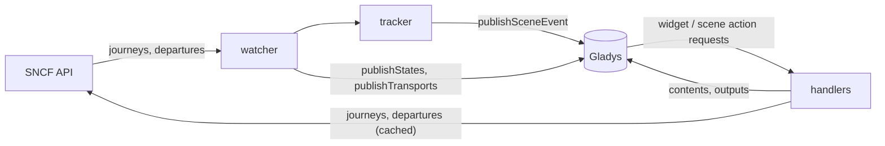
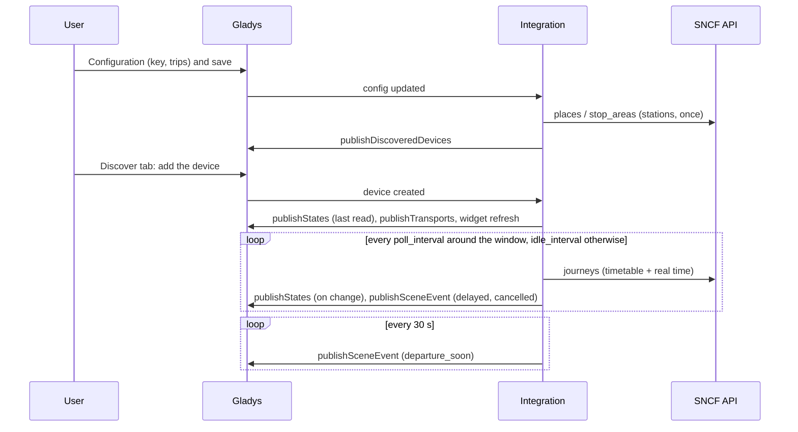
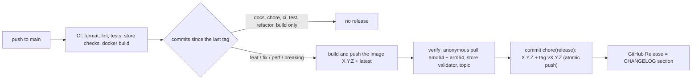

# Gladys SNCF

**English** · [Français](README.fr.md) · [Deutsch](README.de.md) · [Español](README.es.md)

[](LICENSE)
[](https://github.com/William-De71/gladys-sncf/releases)
[](https://github.com/William-De71/gladys-sncf/actions/workflows/release.yml)
[](https://gladysassistant.com)

External [Gladys Assistant](https://gladysassistant.com) integration for **SNCF trains**: the next trains of your
trips in real time — delays, cancellations, causes — as devices, **scene triggers**, a **scene action** and
**dashboard widgets**, built on `@gladysassistant/integration-sdk` 0.15.

Data: the official [SNCF API](https://numerique.sncf.com/startup/api/) (a Navitia instance, free key, 5 000
requests a day). Real time for TGV INOUI, OUIGO, Intercités, TER, Lyria and Eurostar; Transilien is timetable only.

User documentation: [English](docs/en.md) · [Français](docs/fr.md) · [Deutsch](docs/de.md) · [Español](docs/es.md).

> Community integration, not affiliated with or endorsed by SNCF.

## Contents

- [Features](#features)
- [Architecture](#architecture)
- [Installation](#installation)
- [Configuration](#configuration)
- [How it works](#how-it-works)
- [Development](#development)
- [Release and commit convention](#release-and-commit-convention)
- [Troubleshooting](#troubleshooting)
- [Contributing](#contributing)
- [License](#license)

## Features

### Devices

A device per configured trip (up to 3), offered on the Discover tab, all features read-only:

| Feature                 | Category / type              | Notes                                                      |
| ----------------------- | ---------------------------- | ---------------------------------------------------------- |
| Next train              | `text` / `text`              | "07:42 · TER 858311 · +5 min", "… · cancelled"             |
| Delay of the next train | `duration` / `integer` (min) | the next train that runs; left untouched without any train |
| Disrupted trains        | `counter-sensor` / `integer` | followed trains delayed (from the threshold) or cancelled  |

External ids: `ext:<selector>:trip:<UIC from>-<UIC to>[:<feature>]` — retyping a station differently keeps the
device.

Each device carries a transport badge (`transports: ["cloud"]`): `cloud` while the last read of the trip worked,
`unreachable` when it failed, `cloud` flagged **degraded** (with the reason) while the reads are paused by the quota.

### Scene triggers

| Trigger           | Fires when…                                                                        | Filters                                          |
| ----------------- | ---------------------------------------------------------------------------------- | ------------------------------------------------ |
| `train_delayed`   | a followed train becomes late (threshold), then again at 15 and 30 min             | trip (`source: "devices"`), level (multi-select) |
| `train_cancelled` | a followed train is cancelled, or no longer stops at a station of the trip         | trip                                             |
| `departure_soon`  | a followed train leaves in 5/10/15/20/30/45/60 min, on its **real-time** departure | trip, minutes                                    |

Every event carries the trip, the train (number, type, direction), the scheduled / expected times, the delay, the
cause and a ready-made `summary` sentence. Each event fires once per train: what was fired is kept in `/data` for a
day, so a restart never repeats a scene. Reminders are checked every 30 s and fired within 3 minutes of the mark
(the closest one only: a train first seen 8 minutes before leaving fires "10", never "10, 15, 20…").

Example: **SNCF: train leaving soon** (trip "Rennes → Nantes", 15 min) → announce
`{{triggerEvent.data.summary}}` on the speaker ("Rennes → Nantes: the TER 858311 leaves in 15 min, at 07:47 (5
min late).").

### Scene action

`get_next_trains` (trip, empty = the first): number, type, scheduled / expected departure, expected arrival,
delay, status (`on_time` / `delayed` / `cancelled`), minutes until departure, disrupted count, cause and a
`summary` sentence ("Rennes → Nantes: the TER 858311 of 07:42 is 5 min late, leaving at 07:47. Then: 08:12 on
time.").

Example: every weekday at 07:00 → **SNCF: next trains** → send its `summary` output on Telegram.

### Dashboard widgets

| Widget  | Content                                                                                                                                      |
| ------- | -------------------------------------------------------------------------------------------------------------------------------------------- |
| `trip`  | next departure and "leaves in" tiles, then the followed trains with an on time / +N min / cancelled badge; a disrupted train opens its cause |
| `board` | departures board of a station (typed in the settings, or the departure station of a trip), every direction                                   |

`trip` is nudged (`requestWidgetRefresh`) on every change, and both widgets when a device is added. Outside the
travel window, `trip` shows the trains of the next window ("Trains of Tuesday 13 October").

### Languages

English, French, German and Spanish: manifest, runtime messages, widgets, scene summaries and user docs. Gladys
gives the language to the widgets only; device names and scene texts use the **Language of the texts** setting
(`auto` = the language of the last widget request). The causes of the delays come from the SNCF, in French.

## Architecture




From the Discover tab to a state and a scene:



The integration is cloud-only (`transports: ["cloud"]`): it talks to the SNCF web API and nothing on the local
network.

## Installation

From Gladys: **Integrations → store → SNCF → Install**. Then follow the [user documentation](docs/en.md): API key,
trips, **Test the connection**, Discover tab.

Docker image: `ghcr.io/william-de71/gladys-sncf`, multi-arch (amd64/arm64), non-root, read-only rootfs, writes in
`/data` only, OCI labels and the manifest as the `io.gladysassistant.manifest` label.

## Configuration

| Key                               | Type           | Notes                                                                      |
| --------------------------------- | -------------- | -------------------------------------------------------------------------- |
| `api_key`                         | `secret`       | required (the SNCF key, a UUID)                                            |
| `trip_<n>_from` / `trip_<n>_to`   | `string`       | n = 1–3: a station name, a UIC code (`87471003`) or a Navitia id           |
| `trip_<n>_hours`                  | `string`       | optional window, `07:00-09:30`, `7h-9h30`, `06:45 à 08:00`                 |
| `trip_<n>_days`                   | `multi_select` | optional travel days (empty = every day)                                   |
| `train_count`                     | `number`       | trains followed per trip, 1–8, default 4                                   |
| `delay_threshold`                 | `number`       | minutes from which a train is delayed, 1–30, default 5                     |
| `poll_interval` / `idle_interval` | `number`       | minutes between reads around the window (2–30, 3) / otherwise (10–180, 30) |
| `language`                        | `select`       | `auto` (default), `en`, `fr`, `de`, `es`                                   |

Internal key (outside the schema): `last_language`. Manifest actions: `test_connection`, `search_station` (returns
the matching stations with their ids, to paste in a trip field).

## How it works

**Stations.** A name is searched once (`places?type[]=stop_area`, first result) and remembered in
`/data/stations.json`; a UIC code or an id is checked with `stop_areas/<id>`. Stop areas, never stop points: a stop
point is one platform for one kind of train and misses the others.

**Trains.** `journeys` between the two stop areas with `max_nb_transfers=0` and `direct_path=none`; the train is
the single `public_transport` section (the answer frames it with zero-length `crow_fly` sections). Delays come
from `departure_date_time − base_departure_date_time` of the section. Dates are Paris local time without offset,
converted through `Intl` (summer time included), never through the time zone of the container.

**Cancellations.** A cancelled train (`NO_SERVICE`) vanishes from the real-time answers. Each read fetches the
timetable (`base_schedule`) **and** the real time, merged by train number + scheduled departure: a timetable train
linked to a `NO_SERVICE` disruption (by link, or by number and service date in the impacted trip) is cancelled; one
missing while a later train is there is _suspected_, settled on the departures board of the station (cancelled
only when the board proves it absent — never on a guess). A train whose stop at one of the trip stations is
`deleted` (`REDUCED_SERVICE`) is cancelled for that trip. The approach is the one of the Home Assistant
integration [glorp-fr/glorp_sncf_trajets](https://github.com/glorp-fr/glorp_sncf_trajets).

**Schedule and quota.** With a window, the trains of the next window are followed (today's while it is not over,
then the next travel day's) and the trip is read every `poll_interval` minutes from an hour before the window to
its end, every `idle_interval` minutes otherwise; without a window, every `poll_interval` minutes except at night
(00:30–04:30). A read costs 2 requests (3 when a cancellation has to be confirmed): about 250 requests a day per
trip with a 2.5-hour window, 800 without. Requests are counted over a sliding 24 hours in `/data/quota.json`; the
reads pause at 4 500, leaving the rest to the widgets, the scene action and the configuration screen. A `429`
blocks every request until its `Retry-After` (an hour by default). Widgets and the scene action reuse the last
read while it is under 2 minutes old; the board is cached 90 s. The devices are published with
`should_poll: false`: the watcher is the only timer, and states are published only when they change.

**Errors.** `401`/`403` → "key refused" in the connection status; `404 no_solution` → no train; 5xx and network
failures are retried once, then the reads back off up to the idle interval.

## Development

```bash
npm install
npm run format:check
npm run lint
npm test
npx github:GladysAssistant/integration-store . --skip-image-check
docker build -t gladys-sncf .
```

Node 22 or later. The tests (`node --test`) never touch the network: they run against real API answers kept in
[`test/fixtures`](test/fixtures/README.md) and check every widget content with the SDK `validateWidgetContent`.
Beyond the unit tests:

- `test/structure.test.js` compares the device external ids, the feature fields the Discover tab compares and
  every key of the manifest with `test/fixtures/discovery.baseline.json` (version 1.0.0): existing users never
  have to recreate a device;
- `test/i18n.test.js` checks the four languages (manifest, runtime texts, docs, READMEs) and validates the widget
  contents in each;
- `test/release.test.js` covers the release script (version, changelog, bump).

`gladys_version` is `>=5.1.1` (widgets, scene triggers and actions, `source: "devices"`).

For development only, `SNCF_API_URL` points the client to another API and `SNCF_DATA_DIR` moves the files of
`/data`.

## Release and commit convention

Releases are automatic. Every push to `main` runs the Release workflow:



- Commits and PR titles follow [Conventional Commits](https://www.conventionalcommits.org/), in English, written
  for the user: they become the changelog lines. `feat` → minor, `fix` / `perf` → patch, `!` or `BREAKING
CHANGE:` → major.
- `CHANGELOG.md` is generated at the release: never edit it by hand.
- The image is published and checked **before** the manifest on `main` announces the new version.
- Manual run (Actions → Release → Run workflow): `release-as` forces a version, `dry-run` only shows the version
  and the notes.
- A protected `main` would reject the release commit: allow GitHub Actions to bypass the rule, or use a GitHub
  App token.

## Troubleshooting

| Symptom                                 | Likely cause                                                                                |
| --------------------------------------- | ------------------------------------------------------------------------------------------- |
| "The SNCF API key is refused"           | key miscopied from the email (a space, a missing character)                                 |
| "Station not found: …"                  | the name matches no station: use **Find a station** and paste the identifier                |
| "Daily quota of the SNCF API reached"   | the SNCF blocked the key until the time shown: fewer trips without a window, longer refresh |
| "No train found in the followed period" | no direct train between the stations in the window (a change is never followed)             |
| Device names or summaries in English    | set **Language of the texts**, or open an SNCF widget once                                  |

Detailed logs: set the environment variable `DEBUG=gladys-integration-sdk` on the container.

## Contributing

Issues and pull requests are welcome: bug reports with the Gladys version, the integration version and the logs
([issue templates](.github/ISSUE_TEMPLATE)). Feedback on the
[Gladys forum thread](https://community.gladysassistant.com/t/integration-externe-sncf-vos-trains-en-temps-reel-dans-gladys/11037)
too. Security problems: see [SECURITY.md](SECURITY.md).

## License

[Apache-2.0](LICENSE) — see [NOTICE](NOTICE).
